 <!--
  ruhioki | MAXED-OUT GITHUB PROFILE
  Midnight: #0D1117
  Purple:   #A855F7
  Pink:     #EC4899
  GPU Green:#76B900
  Ice White:#E6EDF3
-->

<div align="center">

  <!-- CUSTOM LOCAL BANNER -->
  

  <br/>

  <!-- ANIMATED INTRODUCTION -->
  

  <br/><br/>

  <!-- SOCIAL LINKS -->
  <a href="https://github.com/ruhioki">
    
  </a>
  <a href="https://www.youtube.com/@Lewiesz">
    
  </a>

  <br/><br/>

  
  
  

</div>

---

## About Me


Hey! I'm **ruhioki**, an Artificial Intelligence and Data Science student interested in the technology shaping the future.

My main interests are AI, Machine Learning, GPU technology, computer hardware, and the engineering behind high-performance computing.

I'm building my foundations through coursework, experimentation, and personal projects. My goal is to turn what I learn into practical software and eventually work as an **AI Engineer**.

- Studying Artificial Intelligence and Data Science
- Exploring Python, algorithms, and problem-solving
- Interested in NVIDIA GPUs and accelerated computing
- Learning about AI workloads and computer architecture
- Interested in creative technology, gaming, and content creation
- Building my developer portfolio one project at a time

> Learn deeply. Build thoughtfully. Keep improving.

---

## My Developer Philosophy

<div align="center">

| Principle | What it means to me |
|:--|:--|
| Learn | Understand concepts instead of only memorizing syntax. |
| Build | Turn useful ideas into small, practical projects. |
| Experiment | Test ideas and learn from the results. |
| Improve | Refine code, documentation, and problem-solving. |
| Share | Document useful discoveries and learning progress. |

</div>

---

## My Interests

<table>
  <tr>
    <td width="50%" valign="top">

### Artificial Intelligence

Exploring how intelligent systems learn, reason, recognize patterns, and solve problems.

- Machine Learning fundamentals
- Search and optimization algorithms
- Intelligent applications
- AI-assisted development

    </td>
    <td width="50%" valign="top">

### GPU Technology

Interested in the hardware and parallel computation that power demanding workloads.

- GPU architecture
- Parallel computing concepts
- AI acceleration
- NVIDIA computing ecosystem

    </td>
  </tr>
  <tr>
    <td width="50%" valign="top">

### Data Science

Building a foundation in mathematics, data analysis, and computational methods.

- Linear algebra
- Data representation
- Statistical thinking
- Data-driven problem-solving

    </td>
    <td width="50%" valign="top">

### Creative Technology

Exploring the intersection of software, gaming, and digital creativity.

- Minecraft and map design
- Developer tools
- Digital content creation
- Creative coding ideas

    </td>
  </tr>
</table>

---

## Technology Stack

### Programming Languages

<p>
  
</p>

### Development Tools

<p>
  
</p>

### AI, Data and Computing Interests

<p>
  
  
  
  
</p>

<sub>These icons indicate my technology interests and learning areas. They do not imply professional expertise in every language or tool.</sub>

---

## My Learning Roadmap

```text
FOUNDATIONS
    |
    +-- Python programming
    +-- Data structures and algorithms
    +-- Object-oriented programming
    +-- Mathematics for computing
    |
    v
AI & DATA SCIENCE
    |
    +-- Data analysis
    +-- Linear algebra and statistics
    +-- Machine Learning fundamentals
    +-- Search and optimization
    |
    v
ADVANCED COMPUTING
    |
    +-- Neural networks
    +-- GPU architecture
    +-- Parallel computing
    +-- Accelerated AI workloads
    |
    v
PRACTICAL ENGINEERING
    |
    +-- Build and document projects
    +-- Test and improve implementations
    +-- Explore real-world applications
    +-- Develop an AI engineering portfolio
```

<sub>This is a learning roadmap, not a claim that every stage has already been completed.</sub>

---

## Featured Projects

<table>
  <tr>
    <td width="50%" valign="top">

### [VisionForge AI](https://github.com/ruhioki/VisionForge-AI)

**Area:** Python · Computer Vision

A learning-focused OpenCV toolkit for image processing, document scanning, contour analysis, batch processing, image-quality metrics, benchmarking, and optional ONNX classification. It also includes a clean source-bundle generator.

**Stack:** Python, OpenCV, NumPy, pytest, optional ONNX Runtime.

    </td>
    <td width="50%" valign="top">

### [ClientPulse](https://github.com/ruhioki/ClientPulse)

**Area:** Java · Minecraft Fabric

A Java and Fabric client-side starter scaffold for Minecraft. Performance HUD, feature management, and settings are planned features, not yet implemented.

**Stack:** Java, Fabric, Gradle.

    </td>
  </tr>
  <tr>
    <td width="50%" valign="top">

### AI Traffic in Chennai

**Area:** Search Algorithms · AI

An academic project concept for exploring how search algorithms can represent traffic routes and navigation decisions. It is a learning direction, not a completed public repository.

**Potential stack:** Python, graph algorithms, visualization.

    </td>
    <td width="50%" valign="top">

### GPU Computing Lab

**Area:** GPU Architecture · Performance

A planned project direction for documenting GPU concepts and running reproducible computing experiments. No completed lab repository is linked yet.

**Potential stack:** Python, benchmarking, GPU tools.

    </td>
  </tr>
</table>

The linked repositories are real projects. Items described as concepts or planned directions are labeled accordingly so the portfolio stays accurate.

---

## GitHub Overview

<div align="center">

  

  

</div>

<div align="center">

  

</div>

---

## Contribution Snake

<div align="center">

  <picture>
    <source media="(prefers-color-scheme: dark)" srcset="https://raw.githubusercontent.com/ruhioki/ruhioki/output/github-contribution-grid-snake-dark.svg"/>
    <source media="(prefers-color-scheme: light)" srcset="https://raw.githubusercontent.com/ruhioki/ruhioki/output/github-contribution-grid-snake.svg"/>
    
  </picture>

</div>

<sub>A scheduled GitHub Actions workflow in this repository generates these SVGs and publishes them to the `output` branch.</sub>

---

## My Development Mindset

<div align="center">

  

</div>

I believe a strong developer profile should grow naturally alongside the developer.

My focus is to learn the fundamentals, build useful projects, document the process, and gradually explore more advanced AI and computing concepts.

---

## Beyond the Code

- **Gaming:** Minecraft, Bedwars, Skywars, and map design
- **Hardware:** GPUs, graphics performance, and computer components
- **Content:** Educational AI content and digital creativity
- **Learning:** English communication, technical writing, and continuous improvement

---

## Connect With Me

<div align="center">

  <a href="https://github.com/ruhioki">
    
  </a>

  <a href="https://www.youtube.com/@Lewiesz">
    
  </a>

  <br/><br/>

  
  
  

  <br/><br/>

  *Building my future, one commit at a time.*

</div>

<!-- FOOTER -->
<div align="center">
  
</div>
